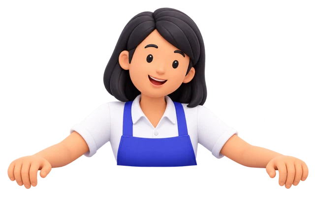

# Karakter utama Ekatra POS

Kedua karakter ini menjadi referensi utama karakter aplikasi Ekatra POS, sesuai pilihan pemilik produk. Gunakan gambar dalam dokumen ini saat membuat pose atau ilustrasi baru. Karakter belum memiliki nama khusus.

## Referensi utama

| Pemilik usaha / kasir | Chef / tim dapur |
| --- | --- |
|  |  |
| Rambut hitam sebahu, kemeja putih, apron indigo, celana gelap, dan sepatu tertutup gelap. | Kumis hitam, topi chef putih, baju chef putih berkancing gelap, celana gelap, dan sepatu tertutup gelap. |

File PNG master disimpan bersama dokumentasi agar referensi tidak bergantung pada direktori hasil generasi:

- [Master karakter perempuan, 1024 × 1536](assets/ekatra-owner-master.png)
- [Master karakter laki-laki, 1024 × 1536](assets/ekatra-chef-master.png)

Keduanya memiliki latar transparan. Master digunakan sebagai referensi untuk generasi atau penyuntingan berikutnya; aplikasi memakai versi WebP yang lebih ringan.

## Tampilan yang dipertahankan

- Ilustrasi 3D dengan bentuk membulat, material halus, dan pencahayaan lembut, sesuai visual hero Ekatra.
- Ekspresi ramah dan menyambut, dengan identitas wajah, rambut, kumis, dan pakaian yang mengikuti gambar referensi.
- Apron perempuan memakai Ekatra Indigo `#5048E5`. Warna brand pendamping mengikuti [identitas Ekatra](../../brand-identity.md).
- Untuk pasangan karakter, gunakan skala tubuh, tinggi penempatan, sudut pandang, dan pencahayaan yang serasi.
- Jika memakai pose seluruh tubuh, tampilkan kedua sepatu secara utuh dan sisakan ruang transparan di bawah telapak. Hindari mencampur karakter yang terpotong dengan karakter yang terlihat utuh.
- Pose boleh berubah sesuai fungsi layar. Pertahankan identitas karakter dan arah pandang yang mendukung konten.

## Pose yang sudah digunakan

### Merangkul paket dari samping

Karakter perempuan berada di kiri Free Starter, menghadap ke kanan. Karakter laki-laki berada di kanan Max Growth, menghadap ke kiri. Tangan berinteraksi dengan tepi kartu, tanpa menutupi teks harga, fitur, atau tombol.

Implementasi saat ini hanya menampilkan pasangan ini pada desktop, mulai lebar 1024px. Penggunaan pada layar lain dapat disesuaikan dengan ruang yang tersedia.

| Karakter | Aset aplikasi |
| --- | --- |
| Perempuan, seluruh tubuh | [ekatra-pricing-cashier-side-v2.webp](../../../public/images/ekatra-pricing-cashier-side-v2.webp) |
| Laki-laki, seluruh tubuh | [ekatra-pricing-chef-side.webp](../../../public/images/ekatra-pricing-chef-side.webp) |

Komponen: [PricingHost](../../../src/pages/landing/components/pricing-host.tsx). Prompt: [pose merangkul paket](../../ui/pricing-host-prompt.md).

### Menyambut di atas form kontak

Versi setengah badan ini digunakan sendiri di atas formulir Hubungi Kami, dengan tangan bertumpu pada tepi atas form.

- [Aset aplikasi](../../../public/images/ekatra-contact-host.webp)
- [Aset mobile](../../../public/images/ekatra-contact-host-mobile.webp)
- [Prompt pose form kontak](../../ui/contact-host-prompt.md)

## Membuat variasi berikutnya

Gambar referensi dan master di atas adalah acuan identitas. Sertakan master karakter yang dipakai sebagai input imagegen, lalu jelaskan perubahan pose, arah pandang, dan area kosong untuk konten aplikasi. Jika membuat kedua karakter sekaligus, sertakan kedua master sebagai referensi.

Contoh arahan: “Gunakan karakter perempuan Ekatra dalam gambar referensi. Pertahankan wajah, rambut hitam sebahu, kemeja putih, apron indigo, celana dan sepatu gelap, serta gaya 3D-nya. Ubah hanya pose menjadi [pose yang diperlukan]. Latar transparan, tanpa tulisan atau panel. Jika seluruh tubuh terlihat, kedua sepatu harus lengkap.”

Master dan pose ini dibuat menggunakan tool imagegen bawaan, kemudian versi WebP disiapkan untuk aplikasi. Simpan hasil pose baru sebagai aset terpisah agar referensi utama tetap tersedia.
