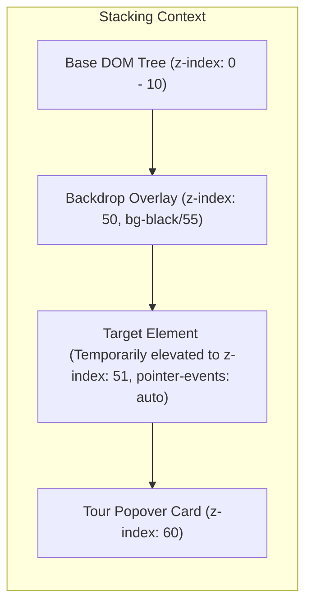
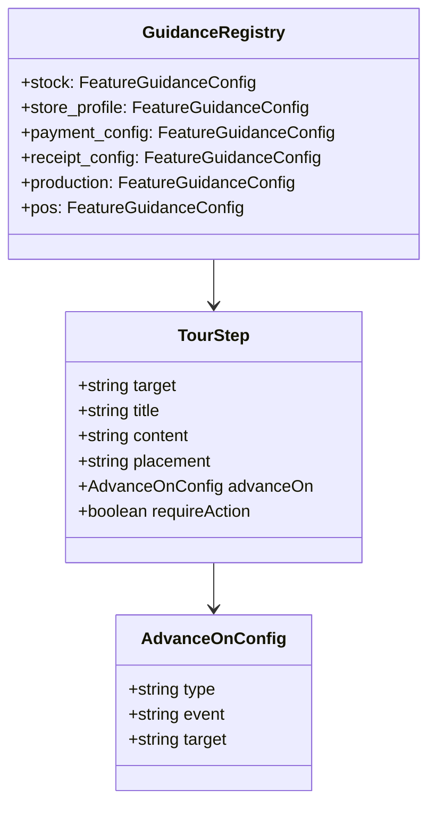

# Technical Specification: Interactive Run-Through Flows for HPP Toko

> **Document Version:** 1.0.0  
> **Status:** Approved Technical Design  
> **Target Package:** `hpp-ui` (React 19 + TypeScript + Vite + Tailwind CSS + TanStack Query)  
> **Author:** Tech Lead & Core Flow Researcher  

---

## 1. Executive Summary & Architectural Overview

The **Interactive Store Guidance System** in HPP Toko provides newly registered merchants and store staff with an interactive, hands-on onboarding experience. Unlike traditional static tooltip tours that merely highlight read-only DOM elements, the **Interactive Run-Through Engine** guides users through genuine store workflows:
1. Creating materials in warehouse inventory.
2. Configuring shop profile, contact info, and business categories.
3. Enabling modern payment channels (QRIS & Bank Transfer).
4. Customizing thermal receipt layouts and branding.
5. Initiating live kitchen production batches with automated recipe stock deductions.
6. Processing point-of-sale cashier transactions with real-time margin and COGS tracking.

### 1.1 Architectural Pillars

```mermaid
flowchart TD
    UserAction["User Action on Highlighted Target"] -->|DOM Event (Click / Input) or Custom Event| EventBus["Guidance Event Bus (advanceOn Listener)"]
    EventBus --> StepValidator{"Validate Step Condition"}
    StepValidator -->|Pass| AdvanceState["Advance to Next Step (setCurrentStepIndex + 1)"]
    StepValidator -->|Fail / Pending| AwaitAction["Await Completion / Display Inline Helper"]
    AdvanceState --> DOMWatcher["MutationObserver / QuerySelector Engine"]
    DOMWatcher --> CalculateCutout["Update Target Cutout & Reposition Popover"]
    CalculateCutout --> HighlightTarget["Elevate Target (z-index: 51) & Adjust Pointer Events"]
    
    subgraph Persistence & Sync
      AdvanceState -.->|On Tour Complete| GuidanceMutation["useCompleteGuidanceMutation()"]
      GuidanceMutation -.-> BackendAPI["PATCH /api/v1/guidance/:key/complete"]
      BackendAPI -.-> RedisCache["Store Guidance State Sync"]
    end
```

The system is built upon three foundational technical components:
- **Spotlight & Cutout Engine (`FeatureGuidanceTour`)**: Creates a visual cutout over target DOM nodes, managing backdrop click blocking and pointer-event pass-through.
- **Event-Driven Step Transition (`advanceOn`)**: Listens to user interactions (`click`, `input`, `change`, or custom application events) to transition seamlessly from one step to the next.
- **Progress Tracking & Resilience**: Integrates with the backend guidance status API (`GET/PATCH /api/v1/guidance`), enabling state caching, dismissal, manual replay, and skip mechanisms.

---

## 2. Interactive Spotlight & Tour Engine Architecture

### 2.1 Cutout Pointer-Events Resolution

A major limitation of traditional tour overlays is that the backdrop click-blocker prevents the user from clicking, typing into, or toggling the highlighted element. To enable true interactive run-throughs, the engine implements an **Elevated Target Stacking Model**:



1. **Backdrop Layer (`z-index: 50`)**:
   - Renders a semi-transparent dark overlay (`rgba(0, 0, 0, 0.55)`).
   - Captures and stops propagation of outside clicks (`onClick={(e) => e.stopPropagation()}`) to prevent accidental navigation while the tour is active.
2. **Interactive Target Layer (`z-index: 51`)**:
   - The engine queries the target element using its selector (`document.querySelector(currentStep.target)`).
   - The target node is dynamically assigned a temporary CSS class `data-guidance-active-target`:
     ```css
     .data-guidance-active-target {
       position: relative !important;
       z-index: 51 !important;
       pointer-events: auto !important;
     }
     ```
   - When the step advances or the tour closes, the engine removes `data-guidance-active-target`, restoring original styles.
3. **Tour Popover Card (`z-index: 60`)**:
   - Positioned dynamically relative to the target element's bounding box (`getBoundingClientRect()`).
   - Floats above both the backdrop and the elevated target node.

### 2.2 Event-Driven Transitions (`advanceOn`)

The `TourStep` type is extended to support declarative event subscriptions:

```typescript
export interface AdvanceOnConfig {
  type: 'click' | 'input' | 'change' | 'custom-event' | 'mutation-success';
  event?: string;             // Custom event name (e.g., 'stock-created', 'sale-completed')
  target?: string;            // Alternate selector if event occurs on a different node than step.target
  validate?: () => boolean;   // Optional predicate validating input completeness
}

export interface TourStep {
  target: string;
  title: string;
  content: string;
  placement?: 'top' | 'bottom' | 'left' | 'right';
  advanceOn?: AdvanceOnConfig;
  requireAction?: boolean;    // If true, disables manual "Selanjutnya" until user performs action
  fallbackTimeoutMs?: number; // Automatic fallback/unlock after period of inactivity
}
```

#### Event Handling Lifecycle:
1. **Mounting the Step**:
   - If `advanceOn.type === 'click'`, a listener is attached to `document.querySelector(step.advanceOn.target || step.target)`.
   - If `advanceOn.type === 'custom-event'`, a listener is registered via `window.addEventListener(step.advanceOn.event, handler)`.
   - If `advanceOn.type === 'input'`, a debounced listener checks whether `(input.value.length >= 2)` before advancing.
2. **Firing the Step Transition**:
   - When the trigger fires, the handler calls `handleNext()`, cleans up the active listeners, and animates the popover to the next target.
3. **Unmounting / Skip Cleanup**:
   - Every event listener is tracked in a local `Map` or `useRef` array and purged upon step transition, component unmount, or when the user presses `Escape`.

---

## 3. Core Feature 1: Bahan Baku & Stok Gudang (`stock`)

### 3.1 Feature Overview
- **Business Purpose**: Bahan baku (raw materials) are the atomic foundation for recipes, COGS (HPP), and inventory valuation in HPP Toko. Every finished product variant relies on stock ingredients with defined units and inventory valuation methods (FIFO / FEFO).
- **Target Page**: `hpp-ui/src/pages/inventory/stock-list-page.tsx`
- **Route**: `/inventory/stocks`
- **Underlying Services & Hooks**: `useStocks()`, `stockService.createStock()`, `useStockSummaryQuery()`

### 3.2 Component & Form Flow Breakdown
1. **List View**: Displays `stock-table` and the primary action button `[data-guidance="add-stock-btn"]`.
2. **Create Material Dialog**:
   - Controlled by state `isCreateOpen`.
   - Form `<form onSubmit={handleSubmitCreate}>`.
   - Fields:
     - Name: `<Input id="stock-name" />` (`newName`)
     - Base Unit: `<DropdownMenu>` trigger `<Button id="stock-unit" />` with options (`kg`, `gram`, `liter`, `ml`, `pcs`, `pack`, `dus`).
     - Inventory Method: `<DropdownMenu>` trigger (FIFO vs. FEFO).
     - Submit button: `<Button type="submit">Simpan Bahan Baku</Button>`.
3. **API & Cache Invalidation**:
   - Mutation calls `stockService.createStock(payload)`.
   - On success: invalidates `stockKeys.all` and `['subscription-usage']`, triggers `refetchSummary()`, and closes modal (`setIsCreateOpen(false)`).

### 3.3 Interactive Step-by-Step Run-Through Flow

| Step # | Step ID | Name & Guided Message | Target DOM Selector | Expected User Action | Transition / Next State | Success Event / Hook | Fallback / Skip |
| :---: | :---: | :--- | :--- | :--- | :--- | :--- | :--- |
| **1** | `stock-intro` | **Daftar Stok & Inventaris**<br/>"Pantau ketersediaan bahan, acuan harga pokok, dan peringatan stok menipis di tabel ini." | `[data-guidance="stock-table"]` | Review table view; click "Selanjutnya" | Popover shifts to Add Material button | Manual Next click | Standard "Lewati" |
| **2** | `stock-open-modal` | **Tambah Bahan Baku Baru**<br/>"Klik tombol ini untuk mendaftarkan bahan baku pertama Anda ke sistem gudang." | `[data-guidance="add-stock-btn"]` | Click "Tambah Bahan Baku" button | Dialog modal opens; `isCreateOpen` becomes `true` | `click` on `[data-guidance="add-stock-btn"]` | "Selanjutnya" button |
| **3** | `stock-input-name` | **Beri Nama Bahan Baku**<br/>"Ketikkan nama bahan baku (contoh: *Tepung Terigu Protein Sedang* atau *Biji Kopi Arabika*)." | `[data-guidance="stock-form-name"]` (or `#stock-name`) | Focus input and enter material name | Input value filled; validation error cleared | `input` event (`value.length >= 3`) | "Selanjutnya" button |
| **4** | `stock-select-unit` | **Tentukan Satuan Dasar (Base Unit)**<br/>"Pilih satuan terkecil yang digunakan saat menakar resep (misal: *kg*, *gram*, atau *ml*)." | `[data-guidance="stock-form-unit"]` (or `#stock-unit`) | Click dropdown and pick unit (e.g. `kg` or `gram`) | Dropdown closes with chosen unit label | `change` / click on dropdown menu item | "Selanjutnya" button |
| **5** | `stock-select-method` | **Metode Inventaris: FIFO vs FEFO**<br/>"Pilih **FIFO** untuk bahan tahan lama/kering, atau **FEFO** jika bahan memiliki tanggal kadaluwarsa cepat." | `[data-guidance="stock-form-method"]` | Select FIFO or FEFO | Method label updates to chosen value | `click` on dropdown menu item | "Selanjutnya" button |
| **6** | `stock-submit` | **Simpan ke Gudang**<br/>"Klik tombol ini untuk menyimpan bahan baku. Stok akan otomatis tercatat dan siap diolah ke dalam resep." | `[data-guidance="stock-form-submit"]` (or button inside dialog) | Click "Simpan Bahan Baku" button | Form submits; API executes; modal closes; table updates | Custom event `stock-created` or `mutation-success` | "Selanjutnya" button |

---

## 4. Core Feature 2: Pengaturan Profil Toko (`store_profile`)

### 4.1 Feature Overview
- **Business Purpose**: The store profile establishes operational identity. Store name, phone number, category, and address are automatically printed on POS sales receipts, purchase orders to suppliers, and financial summaries.
- **Target Page**: `hpp-ui/src/pages/settings/store-settings-page.tsx` (tab: `profile`)
- **Route**: `/settings/store?tab=profile`
- **Underlying Services & Hooks**: `useStoreSettings("profile")`, `settingsService.updateStoreProfile()`, `useAuthStore`

### 4.2 Component & Form Flow Breakdown
1. **Tab Structure**: Rendered within vertical/horizontal `<Tabs>` where `activeTab === 'profile'`.
2. **Profile Form**: `<form onSubmit={handleSaveProfile}>`
   - Store Name: `<Input id="store-name" data-guidance="store-name" />`
   - Business Category: `<select id="store-category">` (`formData.category`)
   - Contact & Address: `<section data-guidance="store-contact">`
     - Phone / WhatsApp: `<Input id="store-phone" />`
     - Physical Address: `<Input id="store-location" />`
     - Description: `<Textarea id="store-desc" />`
   - Save Button: `<Button data-guidance="save-profile-btn" type="submit">Simpan Perubahan Toko</Button>`
3. **API & State Synchronization**:
   - Submits `settingsService.updateStoreProfile(formData)`.
   - On success: updates local state `setStore(updated)`, syncs store list `setStoresList(updatedList)`, and renders green `FeedbackAlert`.

### 4.3 Interactive Step-by-Step Run-Through Flow

| Step # | Step ID | Name & Guided Message | Target DOM Selector | Expected User Action | Transition / Next State | Success Event / Hook | Fallback / Skip |
| :---: | :---: | :--- | :--- | :--- | :--- | :--- | :--- |
| **1** | `profile-name` | **Identitas & Nama Toko**<br/>"Nama toko ini akan tampil sebagai kop resmi nota belanja kasir, faktur PO, dan laporan laba rugi." | `[data-guidance="store-name"]` | Verify or edit store name in the text field | Value validated; required field checked | `input` event (`value.length >= 2`) | "Selanjutnya" button |
| **2** | `profile-category` | **Kategori Industri Bisnis**<br/>"Pilih kategori usaha Anda (misal: Bakery, Coffee Shop, atau Restoran) untuk mengoptimalkan acuan sistem HPP." | `[data-guidance="store-category"]` (or `#store-category`) | Select business category from dropdown | Category value updates in `formData` | `change` event on select | "Selanjutnya" button |
| **3** | `profile-contact` | **Kontak & Alamat Operasional**<br/>"Isi nomor WhatsApp bisnis dan alamat fisik gerai/dapur agar mudah dihubungi pelanggan dan tercetak di struk." | `[data-guidance="store-contact"]` | Fill in phone number and address | Form inputs populated | `input` on phone or location | "Selanjutnya" button |
| **4** | `profile-save` | **Simpan Profil Toko**<br/>"Klik tombol simpan untuk memperbarui identitas outlet Anda secara seketika." | `[data-guidance="save-profile-btn"]` | Click "Simpan Perubahan Toko" button | Save request dispatched; spinner displays; alert shows success | Custom event `store-profile-saved` or submit click | "Selanjutnya" button |

---

## 5. Core Feature 3: Pengaturan Pembayaran Kasir (`payment_config`)

### 5.1 Feature Overview
- **Business Purpose**: Enables multichannel cashless transactions at the checkout counter. Store owners can activate static QRIS payments (for e-wallets and mobile banking apps) and register multiple official bank accounts for manual bank transfers.
- **Target Component**: `hpp-ui/src/features/settings/components/payment-settings-tab.tsx`
- **Route**: `/settings/store?tab=payment`
- **Underlying Services & Data Model**: `StorePaymentConfig` stored within `store.payment_config`, updated via `settingsService.updateStoreProfile({ payment_config: config })`.

### 5.2 Component & Form Flow Breakdown
1. **Cash Tender Section**: Switch `enable_cash` (default enabled).
2. **QRIS Section**: `[data-guidance="payment-qris"]`
   - Switch `<Switch id="enable_qris" />`.
   - When toggled ON: reveals input `#qris_merchant_name` (NMID/Merchant Name) and `#qris_image_url` (URL barcode QRIS).
3. **Bank Transfer Section**: `[data-guidance="payment-bank"]`
   - Switch `<Switch id="enable_bank_transfer" />`.
   - When toggled ON: reveals button `<Button onClick={handleAddBankAccount}>Tambah Rekening</Button>` and dynamic bank card rows (`bank_name`, `account_number`, `account_holder_name`).
4. **Live Interactive Preview**:
   - Right-side column dynamically renders a simulated POS checkout widget displaying the active payment methods, QRIS barcode preview, and bank account copy buttons.
5. **Save Button**: `<Button data-guidance="save-payment-btn" type="submit">Simpan Konfigurasi Pembayaran</Button>`.

### 5.3 Interactive Step-by-Step Run-Through Flow

| Step # | Step ID | Name & Guided Message | Target DOM Selector | Expected User Action | Transition / Next State | Success Event / Hook | Fallback / Skip |
| :---: | :---: | :--- | :--- | :--- | :--- | :--- | :--- |
| **1** | `payment-qris-toggle` | **Aktifkan Pembayaran QRIS**<br/>"Aktifkan switch ini agar kasir dapat menerima pembayaran e-wallet (GoPay, OVO, ShopeePay) dan m-banking." | `[data-guidance="payment-qris"]` | Toggle Switch `enable_qris` to ON | Form reveals QRIS Merchant Name & Image URL fields | Switch `onCheckedChange(true)` | "Selanjutnya" button |
| **2** | `payment-qris-url` | **URL Barcode QRIS Toko**<br/>"Masukkan tautan URL gambar QRIS toko Anda agar kode barcode langsung tampil di layar kasir saat checkout." | `[data-guidance="qris-image-url"]` (or `#qris_image_url`) | Enter image URL into the field | QR preview in the right column updates live | `input` event or click next | "Selanjutnya" button |
| **3** | `payment-bank-setup` | **Rekening Transfer Bank**<br/>"Aktifkan transfer bank dan klik 'Tambah Rekening' untuk mendaftarkan akun bank toko Anda." | `[data-guidance="payment-bank"]` | Toggle switch or click "Tambah Rekening" | Bank account input fields appear | Switch toggled or button clicked | "Selanjutnya" button |
| **4** | `payment-save` | **Simpan Konfigurasi Pembayaran**<br/>"Klik tombol simpan untuk menerapkan metode pembayaran aktif ke seluruh terminal kasir POS." | `[data-guidance="save-payment-btn"]` | Click "Simpan Konfigurasi Pembayaran" button | Form saves; success feedback toast renders | Custom event `payment-config-saved` | "Selanjutnya" button |

---

## 6. Core Feature 4: Pengaturan Struk Kasir (`receipt_config`)

### 6.1 Feature Overview
- **Business Purpose**: Configures the receipt formatting, paper width (58mm vs 80mm), promotional headers, and return-policy footer notes. A professional receipt enhances customer trust and enables offline marketing.
- **Target Component**: `hpp-ui/src/features/settings/components/receipt-settings-tab.tsx`
- **Route**: `/settings/store?tab=receipt`
- **Underlying Services & Data Model**: `StoreReceiptConfig` (`paper_size`, `header_text`, `footer_text`, `show_cashier_name`, `show_customer_phone`, `show_notes`) saved via `settingsService.updateStoreProfile({ receipt_config: config })`.

### 6.2 Component & Form Flow Breakdown
1. **Paper Size Selector**: `[data-guidance="paper-size"]`
   - Two selectable cards: `58mm` (Thermal Mini / Bluetooth Portable) and `80mm` (Thermal Standar / Desktop POS).
   - Selecting a size instantly adjusts the width of the simulated paper in the live preview.
2. **Text Content Inputs**:
   - Header text: `<Input id="header-text" />` (e.g. "Rasanya Bikin Nagih! Cabang Tebet").
   - Footer text: `<Textarea data-guidance="footer-text" id="footer-text" />` (e.g. "Terima kasih! Follow IG @tokoanda").
3. **Optional Detail Toggles**:
   - Switches for `show_cashier_name`, `show_customer_phone`, and `show_notes`.
4. **Live Paper Simulation**:
   - Rendered with thermal mono typography, jagged paper edge styling, barcode mock, and accurate line-item formatting.
5. **Save Button**: `<Button data-guidance="save-receipt-btn" type="submit">Simpan Pengaturan Struk</Button>`.

### 6.3 Interactive Step-by-Step Run-Through Flow

| Step # | Step ID | Name & Guided Message | Target DOM Selector | Expected User Action | Transition / Next State | Success Event / Hook | Fallback / Skip |
| :---: | :---: | :--- | :--- | :--- | :--- | :--- | :--- |
| **1** | `receipt-paper-size` | **Format Ukuran Kertas Thermal**<br/>"Pilih ukuran kertas printer Anda: **58mm** untuk printer bluetooth portabel, atau **80mm** untuk printer kasir desktop." | `[data-guidance="paper-size"]` | Click on `58mm` or `80mm` card | Selected card highlighted; live preview width resizes | `click` on paper option | "Selanjutnya" button |
| **2** | `receipt-header-text` | **Pesan Kop / Slogan Header**<br/>"Tuliskan slogan toko, cabang outlet, atau pesan promosi yang dicetak di bagian paling atas struk." | `[data-guidance="header-text"]` (or `#header-text`) | Type header text | Header line in live preview updates in real-time | `input` event | "Selanjutnya" button |
| **3** | `receipt-footer-text` | **Pesan Penutup & Media Sosial**<br/>"Sampaikan ucapan terima kasih, nomor layanan aduan, atau akun Instagram toko pada bagian bawah struk." | `[data-guidance="footer-text"]` (or `#footer-text`) | Edit footer textarea | Footer text in live preview updates in real-time | `input` event | "Selanjutnya" button |
| **4** | `receipt-save` | **Simpan Format Struk**<br/>"Simpan pengaturan format struk Anda. Desain ini langsung diterapkan saat kasir mencetak nota transaksi." | `[data-guidance="save-receipt-btn"]` | Click "Simpan Pengaturan Struk" button | Save request dispatched; success feedback alert displays | Custom event `receipt-config-saved` | "Selanjutnya" button |

---

## 7. Core Feature 5: Catat Batch Produksi & Masak (`production`)

### 7.1 Feature Overview
- **Business Purpose**: Bridges warehouse raw materials and sellable inventory. When the kitchen bakes or cooks a batch of products, this workflow deducts the exact required ingredient grammages from warehouse stock (via FIFO/FEFO) and calculates the accurate per-unit COGS (HPP).
- **Target Pages**:
  - Batch List: `hpp-ui/src/pages/production/batch-list-page.tsx`
  - Batch Builder: `hpp-ui/src/features/production/components/batch-builder.tsx` (`/production/batches/new`)
- **Route**: `/production/batches` $\rightarrow$ `/production/batches/new` $\rightarrow$ `/production/batches/:id`
- **Underlying Services & Hooks**: `productionService.previewProduction()`, `productionService.startProduction()`, `recipeService.getVariants()`

### 7.2 Multi-Step Wizard Flow Breakdown
The `BatchBuilder` component implements a sequential 3-step wizard:
- **Step 0: Pilih Produk (`step === 0`)**:
  - Filter by category (`Semua`, `Bakery`, `Beverage`, etc.) or search query.
  - Variant cards for products configured as `mode === 'MAKE_TO_STOCK'`.
  - User selects variant (`setSelectedProductId(prod.id)`).
  - Next Button: `<Button onClick={next}>Lanjut ke Target & Audit Stok</Button>`.
- **Step 1: Target & Audit Stok (`step === 1`)**:
  - Target Quantity input: `<Input type="number" value={targetQuantity} />`.
  - Preset buttons (`10`, `20`, `50`, `75`, `100`).
  - Automated Live Inventory Audit via `productionService.previewProduction`:
    - Compares recipe grammage $\times$ target quantity against available stock batches.
    - Warns if stock is deficient (shortfall indicator).
  - Chef / PIC name: `<Input value={chefName} />`.
  - Next Button: `<Button onClick={next}>Review & Konfirmasi</Button>`.
- **Step 2: Review & Konfirmasi (`step === 2`)**:
  - Financial breakdown card: Target units, total batch cost, unit COGS (HPP), expected gross profit.
  - Final CTA: `<Button onClick={() => handleSubmit()}>Mulai Produksi Sekarang</Button>`.
  - Submits `startProduction({ variantId, targetQuantity, notes })`.
  - On success: navigates to `/production/batches/:id` (Live Batch Progress / Kanban Tracker).

### 7.3 Interactive Step-by-Step Run-Through Flow

| Step # | Step ID | Name & Guided Message | Target DOM Selector | Expected User Action | Transition / Next State | Success Event / Hook | Fallback / Skip |
| :---: | :---: | :--- | :--- | :--- | :--- | :--- | :--- |
| **1** | `prod-list-new-btn` | **Mulai Batch Produksi Baru**<br/>"Klik tombol ini untuk memulai proses masak baru di dapur dan memotong stok bahan secara otomatis." | `[data-guidance="new-batch-btn"]` | Click "Mulai Batch Baru" button | Navigates to `/production/batches/new`; opens Batch Builder | Route change / navigation | "Selanjutnya" button |
| **2** | `prod-select-product` | **Pilih Resep / Produk yang Diproduksi**<br/>"Pilih produk Make-to-Stock yang akan dimasak (misal: *Roti Sobek Cokelat*)." | `[data-guidance="batch-product-select"]` | Click on a product card in the grid | Product becomes active (`selectedProductId`); card shows border check | `click` on product card | "Selanjutnya" button |
| **3** | `prod-target-qty` | **Tentukan Target Porsi / Unit Produksi**<br/>"Ketikkan berapa porsi atau pcs yang akan dimasak hari ini, atau pilih preset cepat (10, 20, 50 pcs)." | `[data-guidance="batch-target-qty"]` | Input target quantity or click preset | Target quantity updates; live stock deduction recalculates | `input` / `change` event | "Selanjutnya" button |
| **4** | `prod-stock-audit` | **Audit Ketersediaan Stok Otomatis**<br/>"Sistem otomatis memeriksa apakah sisa stok tepung, gula, dan telur mencukupi sebelum produksi dimulai." | `[data-guidance="batch-stock-audit"]` | Review ingredient consumption list | Displays green/amber status indicators for stock availability | Click "Lanjut ke Review" | "Selanjutnya" button |
| **5** | `prod-submit-batch` | **Konfirmasi & Mulai Masak**<br/>"Periksa estimasi HPP pokok per unit, lalu klik 'Mulai Produksi Sekarang' untuk memulai proses batch." | `[data-guidance="batch-submit-btn"]` | Click "Mulai Produksi Sekarang" button | Batch created in DB; stock locked; redirected to batch detail | Navigation to `/production/batches/:id` | "Selanjutnya" button |

---

## 8. Core Feature 6: Kasir & Transaksi Penjualan (`pos`)

### 8.1 Feature Overview
- **Business Purpose**: The Point of Sale (POS) is the primary revenue engine. It allows cashiers to take orders, customize items, apply discounts, choose payment channels (Cash, QRIS, Bank Transfer), track real-time gross margin per basket, and print customer receipts.
- **Target Page**: `hpp-ui/src/pages/sales/pos-page.tsx`
- **Route**: `/sales/pos`
- **Underlying Services & Hooks**: `usePosProducts()`, `salesService.createSale()`, `useStoreSettings()`

### 8.2 Component & Transaction Flow Breakdown
1. **Catalog Section (`[data-guidance="pos-catalog"]`)**:
   - Product cards grid with category filter tabs and search input.
   - Clicking a product card calls `handleAddToCart(product)` (or opens modifier options dialog if configurable).
2. **Order Cart Sidebar (`[data-guidance="pos-cart"]`)**:
   - Lists added line items, unit quantities with `+` / `-` steppers, and item deletion.
   - Live KPI: Displays total item count, total price, and real-time **Estimasi Laba Kotor** (`estimatedGrossProfit`) and margin percentage (`estimatedMarginPct`).
3. **Checkout Button (`[data-guidance="pos-checkout"]`)**:
   - `<Button data-guidance="pos-checkout" onClick={handleOpenPayment}>Bayar Sekarang (F2 / Spasi)</Button>`.
   - Opens `<Dialog open={isPaymentOpen}>`.
4. **Payment Modal (`isPaymentOpen`)**:
   - Left side: Order item review and customer phone lookup.
   - Right side: Payment method selector (`CASH`, `QRIS`, `TRANSFER`).
   - Cash Tender Flow: Shows quick nominal presets (`Uang Pas`, Rp 50.000, Rp 100.000), cash input field, and live change calculation (`Kembalian`).
   - Submit Button: `<Button onClick={handleExecutePayment}>Konfirmasi & Selesaikan Transaksi</Button>`.
5. **Receipt Modal (`isReceiptOpen`)**:
   - Automatically opens upon successful payment execution.
   - Renders digital invoice preview, "Cetak Struk Thermal", and "Transaksi Baru" action buttons.

### 8.3 Interactive Step-by-Step Run-Through Flow

| Step # | Step ID | Name & Guided Message | Target DOM Selector | Expected User Action | Transition / Next State | Success Event / Hook | Fallback / Skip |
| :---: | :---: | :--- | :--- | :--- | :--- | :--- | :--- |
| **1** | `pos-add-item` | **Pilih Produk dari Katalog**<br/>"Klik salah satu kartu produk untuk memasukkan item pertama ke dalam keranjang belanja pelanggan." | `[data-guidance="pos-catalog"]` | Click on any product card in the catalog | Item is appended to cart state; cart counter increments | `cart.length > 0` or card click | "Selanjutnya" button |
| **2** | `pos-review-cart` | **Periksa Keranjang & Margin Laba**<br/>"Perhatikan estimasi laba kotor yang dihitung otomatis dari HPP bahan baku setiap item secara langsung." | `[data-guidance="pos-cart"]` | Review item list, quantities, and gross profit | Cart items visible; gross profit percentage shown | Manual Next or click | "Selanjutnya" button |
| **3** | `pos-open-checkout` | **Lanjut ke Pembayaran**<br/>"Klik tombol 'Bayar Sekarang' (atau tekan F2 di keyboard) untuk membuka dialog kasir." | `[data-guidance="pos-checkout"]` | Click "Bayar Sekarang" button | Payment dialog opens; `isPaymentOpen` becomes `true` | `click` on checkout button | "Selanjutnya" button |
| **4** | `pos-select-method` | **Pilih Metode Pembayaran**<br/>"Pilih metode pembayaran: Tunai (Cash), scan QRIS, atau Transfer Bank sesuai permintaan pembeli." | `[data-guidance="pos-payment-methods"]` | Click payment method tab (e.g. `CASH` or `QRIS`) | Selected payment tab highlighted; shows cash tender / QR code | Click on payment method button | "Selanjutnya" button |
| **5** | `pos-execute-sale` | **Selesaikan Transaksi & Cetak Struk**<br/>"Klik 'Konfirmasi & Selesaikan Transaksi' untuk memotong stok produk dan mencetak struk nota pelanggan." | `[data-guidance="pos-confirm-payment"]` | Click "Konfirmasi & Selesaikan Transaksi" button | Sale API executes; cart resets; receipt dialog opens | Custom event `sale-completed` | "Selanjutnya" button |
| **6** | `pos-receipt-modal` | **Nota Transaksi Selesai 🎉**<br/>"Struk belanja pelanggan siap dicetak ke printer thermal atau dikirim ke WhatsApp pelanggan!" | `[data-guidance="pos-receipt-modal"]` | Review receipt or click "Transaksi Baru" | Closes receipt dialog; completes POS guidance tour | Click "Transaksi Baru" / complete tour | "Selesai" button |

---

## 9. Comprehensive Technical Matrix & Selector Registry

The following table provides the exhaustive registry of all DOM targets, states, events, and fallback behaviors across all 6 core modules:



| Feature Key | Step Index | Step ID | Target Selector | Action Type | Advance Event / Trigger | Cache Invalidation / Side Effect |
| :--- | :---: | :--- | :--- | :--- | :--- | :--- |
| `stock` | 0 | `stock-table` | `[data-guidance="stock-table"]` | View | Manual / `click` | None |
| `stock` | 1 | `stock-add-btn` | `[data-guidance="add-stock-btn"]` | Click | `click` $\rightarrow$ modal opens | `isCreateOpen = true` |
| `stock` | 2 | `stock-name-input` | `[data-guidance="stock-form-name"]` | Input | `input` (`length >= 3`) | Sets `newName` |
| `stock` | 3 | `stock-unit-select` | `[data-guidance="stock-form-unit"]` | Select | Dropdown item `click` | Sets `newBaseUnit` |
| `stock` | 4 | `stock-method-select`| `[data-guidance="stock-form-method"]`| Select | Dropdown item `click` | Sets `newMethod` |
| `stock` | 5 | `stock-submit-btn` | `[data-guidance="stock-form-submit"]`| Submit | `stock-created` custom event | Invalidate `stockKeys.all` |
| `store_profile` | 0 | `profile-name` | `[data-guidance="store-name"]` | Input | `input` (`length >= 2`) | Sets `formData.name` |
| `store_profile` | 1 | `profile-category` | `[data-guidance="store-category"]` | Select | `change` on select | Sets `formData.category` |
| `store_profile` | 2 | `profile-contact` | `[data-guidance="store-contact"]` | Input | `input` on phone/location | Sets `formData.phone` |
| `store_profile` | 3 | `profile-save-btn` | `[data-guidance="save-profile-btn"]` | Submit | `store-profile-saved` event | Updates store in AuthStore |
| `payment_config` | 0 | `payment-qris` | `[data-guidance="payment-qris"]` | Toggle | Switch `onCheckedChange` | Sets `enable_qris = true` |
| `payment_config` | 1 | `payment-qris-url` | `[data-guidance="qris-image-url"]` | Input | `input` on URL field | Live preview sync |
| `payment_config` | 2 | `payment-bank` | `[data-guidance="payment-bank"]` | Toggle / Add | Button `click` | Appends `bank_accounts` |
| `payment_config` | 3 | `payment-save-btn` | `[data-guidance="save-payment-btn"]` | Submit | `payment-config-saved` event | Updates `payment_config` |
| `receipt_config` | 0 | `receipt-paper` | `[data-guidance="paper-size"]` | Select | Option button `click` | Resizes preview paper |
| `receipt_config` | 1 | `receipt-header` | `[data-guidance="header-text"]` | Input | `input` on header field | Real-time text update |
| `receipt_config` | 2 | `receipt-footer` | `[data-guidance="footer-text"]` | Input | `input` on footer field | Real-time text update |
| `receipt_config` | 3 | `receipt-save-btn` | `[data-guidance="save-receipt-btn"]` | Submit | `receipt-config-saved` event | Updates `receipt_config` |
| `production` | 0 | `prod-new-btn` | `[data-guidance="new-batch-btn"]` | Click | `click` $\rightarrow$ navigates | Route `/production/batches/new` |
| `production` | 1 | `prod-select-prod` | `[data-guidance="batch-product-select"]`| Click | Product card `click` | Sets `selectedProductId` |
| `production` | 2 | `prod-target-qty` | `[data-guidance="batch-target-qty"]` | Input | `input` on quantity field | Triggers `previewProduction` |
| `production` | 3 | `prod-stock-audit` | `[data-guidance="batch-stock-audit"]` | View / Next | Click "Lanjut ke Review" | Wizard advances to Step 2 |
| `production` | 4 | `prod-submit` | `[data-guidance="batch-submit-btn"]` | Submit | `batch-created` custom event | Invalidate `["production"]` |
| `pos` | 0 | `pos-catalog` | `[data-guidance="pos-catalog"]` | Click | Product card `click` | Adds item to `cart` |
| `pos` | 1 | `pos-cart` | `[data-guidance="pos-cart"]` | View | Manual / `click` | Review margin percentage |
| `pos` | 2 | `pos-checkout-btn` | `[data-guidance="pos-checkout"]` | Click | `click` on checkout button | Opens `isPaymentOpen = true` |
| `pos` | 3 | `pos-pay-method` | `[data-guidance="pos-payment-methods"]` | Select | Tab `click` (`CASH`/`QRIS`) | Selects active tender |
| `pos` | 4 | `pos-confirm-pay` | `[data-guidance="pos-confirm-payment"]` | Submit | `sale-completed` custom event | Opens `isReceiptOpen = true` |
| `pos` | 5 | `pos-receipt` | `[data-guidance="pos-receipt-modal"]` | Complete | Button `click` / Finish | Guidance complete sync |

---

## 10. Implementation Guide & Code Recommendations

### 10.1 Extending `TourStep` in `types/index.ts`

```typescript
export interface AdvanceOnConfig {
  type: 'click' | 'input' | 'change' | 'custom-event';
  event?: string;
  target?: string;
  validate?: (element: HTMLElement) => boolean;
}

export interface TourStep {
  target: string;
  title: string;
  content: string;
  placement?: 'top' | 'bottom' | 'left' | 'right';
  advanceOn?: AdvanceOnConfig;
  requireAction?: boolean;
}
```

### 10.2 Implementing `advanceOn` Listeners in `FeatureGuidanceTour`

```typescript
// Inside FeatureGuidanceTour.tsx
React.useEffect(() => {
  if (!isTourActive || !currentStep?.advanceOn) return;

  const { type, event, target: customTarget, validate } = currentStep.advanceOn;
  const targetSelector = customTarget || currentStep.target;
  const targetElement = document.querySelector(targetSelector);

  if (type === 'custom-event' && event) {
    const handleCustomEvent = () => {
      handleNext();
    };
    window.addEventListener(event, handleCustomEvent);
    return () => window.removeEventListener(event, handleCustomEvent);
  }

  if (targetElement) {
    if (type === 'click') {
      const handleClick = () => {
        handleNext();
      };
      targetElement.addEventListener('click', handleClick);
      return () => targetElement.removeEventListener('click', handleClick);
    }

    if (type === 'input' || type === 'change') {
      const handleInput = (e: Event) => {
        const input = e.target as HTMLInputElement;
        if (validate ? validate(input) : (input.value && input.value.trim().length > 0)) {
          // Debounce to allow user to finish typing
          const timer = setTimeout(() => handleNext(), 700);
          return () => clearTimeout(timer);
        }
      };
      targetElement.addEventListener(type, handleInput);
      return () => targetElement.removeEventListener(type, handleInput);
    }
  }
}, [isTourActive, currentStep, handleNext]);
```

### 10.3 Dynamic Target Elevation & Pointer Events

```typescript
// Elevated z-index handling during active step
React.useEffect(() => {
  if (!isTourActive || !currentStep) return;

  const el = document.querySelector(currentStep.target) as HTMLElement | null;
  if (el) {
    el.classList.add('guidance-interactive-target');
  }

  return () => {
    if (el) {
      el.classList.remove('guidance-interactive-target');
    }
  };
}, [isTourActive, currentStep]);
```

With matching CSS utility in global stylesheet or component:
```css
.guidance-interactive-target {
  position: relative !important;
  z-index: 51 !important;
  pointer-events: auto !important;
  box-shadow: 0 0 0 4px hsl(var(--primary) / 0.35) !important;
  border-radius: 8px;
  transition: box-shadow 0.2s ease-in-out;
}
```

### 10.4 Dispatching Success Events in Feature Handlers
To make interactions reliable and decoupled, dispatch standard events from feature handlers upon mutation success:
- **Material Added (`stock-list-page.tsx`)**:
  ```typescript
  window.dispatchEvent(new CustomEvent('stock-created', { detail: { stock: newStock } }));
  ```
- **Store Profile Saved (`store-settings-page.tsx`)**:
  ```typescript
  window.dispatchEvent(new CustomEvent('store-profile-saved', { detail: { store: updated } }));
  ```
- **Payment Saved (`payment-settings-tab.tsx`)**:
  ```typescript
  window.dispatchEvent(new CustomEvent('payment-config-saved', { detail: { config } }));
  ```
- **Receipt Saved (`receipt-settings-tab.tsx`)**:
  ```typescript
  window.dispatchEvent(new CustomEvent('receipt-config-saved', { detail: { config } }));
  ```
- **Production Started (`batch-builder.tsx`)**:
  ```typescript
  window.dispatchEvent(new CustomEvent('batch-created', { detail: { batch: newBatch } }));
  ```
- **Sale Completed (`pos-page.tsx`)**:
  ```typescript
  window.dispatchEvent(new CustomEvent('sale-completed', { detail: { sale: completedSale } }));
  ```

---

## 11. Verification & Testing Strategy

1. **DOM Selector Integrity Tests**:
   - Automated unit test asserting that all selectors defined in `GUIDANCE_REGISTRY` resolve to actual elements on their respective pages.
2. **Interactive Run-Through E2E Specs (Playwright)**:
   - Run full end-to-end user journeys verifying that typing, toggling switches, and clicking buttons advances the tour seamlessly to the completion celebration toast.
3. **Graceful Fallback & Keyboard Accessibility**:
   - Verify that pressing `Escape` skips the tour and saves skipped state to the backend without causing UI lockups.
   - Verify that keyboard navigation (`Tab`, `Enter`, `Space`) works on elevated interactive targets.
